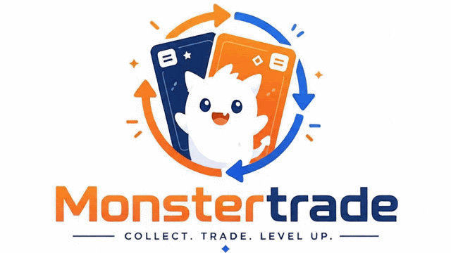

# Monstertrade



A free Pokémon collection app with browser-local collections and a serverless public price service for Cloudflare. The app and Cloudflare Worker use the name Monstertrade (`monstertrade` in deployment configuration). No application account or paid API key is required.

[Contributing](CONTRIBUTING.md) · [Git Flow](docs/GIT_FLOW.md) · [Security reports](SECURITY.md)

## Run locally

Use Node.js 24 (the version in `.nvmrc`) and npm. Install the pinned deployment tools, create the local price tables, and start the full app:

```sh
npm ci --ignore-scripts
npm run db:migrate:local
npm run dev:cloudflare
```

Open the localhost URL printed by Wrangler. Local D1 data lives under the ignored `.wrangler/` directory. The database ID in the checked-in configuration is a local-development placeholder; these commands do not create a remote database or require Cloudflare login.

Run the same checks as GitHub CI without publishing:

```sh
npm run check
npm test
npm run test:smoke
npm run check:deploy
npm run check:deploy:staging
```

`check` validates syntax, configuration, and local assets. `test:smoke` migrates a fresh, isolated local D1 database and exercises the real Worker, health endpoint, and static assets.

The dry run validates bundling and configuration, but does not verify a remote database, execute remote migrations, or activate scheduled jobs.

`npm start` still serves `dist/` at [localhost:4173](http://127.0.0.1:4173) without installing dependencies. This static-only preview supports the collection interface and direct catalogue requests, but has no shared price API or public price history. Use the Wrangler preview for the complete experience. Neither local preview server is used in production.

## Deploy to your Cloudflare account

The project uses [Workers Static Assets](https://developers.cloudflare.com/workers/static-assets/get-started/), a Worker for `/api/*`, and a D1 database containing public quotations. Other matching asset requests are served directly. There is no application login or cloud collection synchronization.

After local validation, authenticate and create the public price database once:

```sh
npx wrangler login
npm run db:create
```

`db:create` runs `wrangler d1 create monsterstrade-prices --binding PRICES_DB --update-config`. It creates a **remote** database and replaces the matching binding's local placeholder with the returned UUID. Verify that `wrangler.jsonc` contains exactly one `PRICES_DB` binding with that real `database_id`. If the database already exists, run `npx wrangler d1 list` and put its UUID in the existing binding instead of creating another database. The database retains its original technical name, `monsterstrade-prices`, so the branding update does not change the data binding.

Apply the remote schema, then publish:

```sh
npm run db:migrate:remote
npm run deploy
```

The deploy script stops before publishing if `PRICES_DB` has no real UUID. It accepts `CLOUDFLARE_DATABASE_ID` as a deployment override, so a real database identifier does not need to be committed. The ordinary `npm run deploy` command does not create resources or apply migrations. Use `npm run deploy -- --migrate` to apply outstanding remote migrations before publishing; this is the command used by CD. A migration failure stops deployment.

Wrangler prints the `https://monstertrade.<your-subdomain>.workers.dev` address. Verify `/api/health`, open a catalogue card to acquire its first public quote, and check Cloudflare's scheduled invocation metrics after deployment. The five-minute Cron schedule becomes active only after a real deployment; local preview and dry runs do not activate it.

There is no build step. Node.js is needed for development and deployment tooling, not for a continuously running application server. Any checkout-local `.openai/hosting.json` belongs to the earlier Sites publication. It is ignored and is not part of this Cloudflare deployment or the GitHub source package.

A custom domain is optional and registration is a separate cost. After adding its active zone to Cloudflare, use the Worker's **Settings → Domains & Routes → Add → Custom Domain**. See the [custom domain guide](https://developers.cloudflare.com/workers/configuration/routing/custom-domains/).

## GitHub Actions and production setup

`main` is the default branch and production source. Normal work targets `develop`, which deploys to public staging. Releases and hotfixes reach `main` through versioned branches; see [Git Flow](docs/GIT_FLOW.md) for commands and branch rules.

| Environment | Branch | Worker | D1 database |
| --- | --- | --- | --- |
| Production | `main` | [monstertrade](https://monstertrade.loch3f.workers.dev) | `monsterstrade-prices` |
| Staging | `develop` | [monstertrade-staging](https://monstertrade-staging.loch3f.workers.dev) | `monsterstrade-prices-staging` |

Staging has its own Worker, price cache, history, and schedule. Both environments use the same Cloudflare account, with deployment credentials stored separately in GitHub environments `staging` and `production`. Use separate expiring tokens with the minimum available Cloudflare permissions; separate secret storage does not narrow the permissions granted by Cloudflare. Collections remain in each browser origin's local storage; use JSON export/import when deliberately transferring a collection between environments.

| Workflow | Trigger | Result |
| --- | --- | --- |
| **CI / Checks** | Pull requests and pushes to `main`, `develop`, `release/**`, and `hotfix/**` | Validates source/configuration/assets, checks high/critical dependency advisories, runs tests and an isolated local Worker smoke test, and checks both deployment bundles without cloud credentials. |
| **CI / Git Flow** | The same CI events | Legacy PR feedback during rollout; checks branch routing, commit conventions, ancestry, and release versions. |
| **Trusted Git Flow policy** | PR metadata events, after activation on `main` | Publishes a separate required `Git Flow` commit status from the reviewed immutable policy revision, without executing PR code. |
| **Deploy to Cloudflare** | Successful push CI for `main` or `develop`, or a matching manual run | Independently revalidates the latest merged PR from pinned policy, migrates its D1 database, publishes its Worker, and checks health. Automatic runs require the corresponding enable flag. Successful production releases receive an immutable version tag. |

Create GitHub environments `staging` and `production` under **Settings → Environments** and configure the environment secrets below. Configure repository variables under **Settings → Secrets and variables → Actions**. The official [Cloudflare CI authentication guide](https://developers.cloudflare.com/workers/ci-cd/external-cicd/github-actions/#1-authentication) explains account-scoped tokens, and [GitHub's repository-secret guide](https://docs.github.com/en/actions/how-tos/write-workflows/choose-what-workflows-do/use-secrets#creating-secrets-for-a-repository) shows where to save them.

| Type | Name | Value |
| --- | --- | --- |
| Environment secret (each target) | `CLOUDFLARE_API_TOKEN` | A Cloudflare token scoped to the target account with Workers deployment permissions and **Account → D1 → Edit** for migrations. See [D1 token permissions](https://developers.cloudflare.com/d1/tutorials/import-to-d1-with-rest-api/#1-create-a-d1-api-token). |
| Environment secret (each target) | `CLOUDFLARE_ACCOUNT_ID` | The Cloudflare account containing the Worker and database. |
| Repository variable | `GIT_FLOW_POLICY_SHA` | Full SHA of the reviewed policy commit; required by trusted PR and independent pre-deployment checks. Follow [activation](docs/GIT_FLOW.md#trusted-policy-and-activation) before changing this pin. |
| Repository variable | `CLOUDFLARE_DATABASE_ID` | The UUID of the existing `monsterstrade-prices` D1 database. |
| Repository variable | `CLOUDFLARE_STAGING_DATABASE_ID` | The UUID of the separate `monsterstrade-prices-staging` D1 database. Must differ from production. |
| Repository variable | `CLOUDFLARE_DEPLOY_ENABLED` | Set to `true` when automatic production deployment after successful CI is wanted. Leave absent until setup is complete. |
| Repository variable | `CLOUDFLARE_STAGING_DEPLOY_ENABLED` | Set to `true` when automatic staging deployment after successful CI is wanted. |
| Repository variable | `MONSTERTRADE_URL` | Production health-check origin: `https://monstertrade.loch3f.workers.dev`. |
| Repository variable | `MONSTERTRADE_STAGING_URL` | Staging health-check origin: `https://monstertrade-staging.loch3f.workers.dev`. |

Use HTTPS origins with no path beyond `/`, credentials, query, or fragment. Create production D1 once using the preceding instructions. Create staging D1 once with `npx wrangler d1 create monsterstrade-prices-staging`, then save its returned UUID in `CLOUDFLARE_STAGING_DATABASE_ID`. An existing database can be found with `npx wrangler d1 list`; do not recreate it on each deployment.

Keep credentials in GitHub secrets, not in YAML or the repository. Deployment injects database overrides and the full verified `DEPLOY_SHA` as Worker variable `DEPLOY_COMMIT` into temporary configuration under ignored `.wrangler/deploy-*/`, then removes it; it never edits `wrangler.jsonc`. The checked-in placeholders support uncredentialed CI. Passing `--dry-run`, including with `--migrate`, never applies remote migrations. With both database IDs available in the local environment, `npm run deploy -- --staging --migrate` migrates and publishes staging; the script rejects a shared production/staging database.

For a manual deployment, use **Actions → Deploy to Cloudflare → Run workflow** and select `main` with target `production`, or `develop` with target `staging`. The selected branch and target must agree. Manual runs repeat validation before deployment. Once each environment is configured, enable its automatic deployment flag. Only the latest successful push CI revision of that environment's branch can deploy automatically; stale revisions are rejected. Deployments within each environment run sequentially.

PRs and other branches receive no deployment credentials. Deploy jobs have read-only GitHub permissions. Only the production tagging job receives `contents: write`: after deployment, schema health, and an exact `health.deployCommit` match succeed, it creates `vX.Y.Z` at the deployed SHA. A tag already pointing to that SHA is accepted; a conflicting tag fails preflight and is never moved. See [release and recovery guidance](docs/GIT_FLOW.md#releases-and-hotfixes).

The deploy job selects its GitHub environment only after independent policy validation. Restrict `production` to workflow ref `main`; restrict `staging` to `main` and `develop`. A `workflow_run` deployment uses default `main` as its workflow ref even for a verified `develop` candidate, while manual staging uses `develop`. The independent policy and release gates verify the actual target branch and SHA. Environment and branch rules are separate GitHub settings; feature availability depends on visibility and plan. See [repository settings](CONTRIBUTING.md#repository-settings) for the intended merge policy. Workflow files alone do not enforce it.

The install steps use `npm ci --ignore-scripts`; the credentialed job restores no dependency cache. This blocks dependency install hooks from persisting into later steps, but deployment tooling itself still runs with deployment privileges. Review locked dependency changes. CI fails on high or critical npm advisories; GitHub secret scanning, push protection, and Dependabot alerts are repository settings that should stay enabled.

During rollout, configure environment secrets and `GIT_FLOW_POLICY_SHA` before the new default-branch workflow activates. Preserve legacy repository secrets until that workflow has reached `main` and both environment deployments have been verified; then remove the repository copies and rotate superseded tokens. A feature-branch-only workflow edit does not activate production hardening. See [policy activation](docs/GIT_FLOW.md#trusted-policy-and-activation).

A failed deployment or post-deployment health check needs investigation before retrying. A successful migration is not undone if publishing fails. Likewise, rolling back the Worker does not undo D1 schema changes; write compatible migrations and confirm database state before a rollback. The public price database can be rebuilt from sources going forward, but discarded historical observations are not automatically recoverable.

## Features

- Search the public Pokémon catalogue in English or Italian; track quantities, per-card purchase costs, condition, and binders.
- Search sealed products by name, set and type: booster packs, booster boxes, Elite Trainer Boxes, collections, tins, blisters and bundles. Track quantities as whole sealed products, with per-product costs and packaging condition. Filter cards and sealed holdings separately in the collection.
- Add custom sealed products with edition, language, product code and source link. Record dated personal valuations and review their local history, including multiple observations on the same day.
- Record the exact catalogue variant where available, including finishes and special prints. Different variants, grading records, and personal valuation evidence remain separate entries.
- Record grading company and grade without assigning an unsupported graded market price.
- Add an optional personal valuation in EUR with its date, note, and source link. It remains separate from purchase cost and the provider's quote, survives refreshes, and is explicitly identified when used in collection totals.
- View price source, provider date, last acquisition/attempt, and missing, stale, failed, or unverified states. A generic market reference remains labelled as such.
- Refresh collection and wishlist references, with automatic refresh when returning to the app as needed. The shared cache prevents the manual button from repeatedly fetching the same provider data.
- View shared per-card reference history and local aggregate collection snapshots. Coverage shows how many holdings have prices, personal valuations, old references, or no usable quote.
- Save wishlist targets, organize binders, and track set progress by distinct card IDs.
- Export collection rows to CSV or the complete local state to JSON. CSV merges rows; JSON restore replaces local collection, wishlist, binders, and aggregate history after a preview. Imports and removals offer a temporary undo action until another change is saved.

## How prices are handled

Card metadata and artwork come from [TCGdex](https://tcgdex.dev/). The shared service requests canonical English card records from TCGdex and stores Cardmarket EUR reference prices. Catalogue language and the language of a physical card do **not** establish that the market quote is language-specific. TCGdex documents daily Cardmarket updates; repeated requests do not imply a newer price. See [TCGdex pricing](https://tcgdex.dev/markets-prices) and [coverage limitations](https://tcgdex.dev/faq).

The default generic reference is the positive, finite EUR `pricing.cardmarket.trend`. A price observation records source, metric, product ID, provider timestamp, fetch/attempt timestamps, and mapping status. References older than 48 hours are labelled stale. Failed refreshes keep the prior observation and report the failure; a successful response with no usable price leaves the current price unavailable and keeps the prior valid observation separately in the browser. Late responses cannot silently replace a newer observation.

**Variant pricing is deliberately conservative.** `variants_detailed` identifies available variants, but a third-party product ID alone does not prove the correct price field. In particular, a printed holo does not universally correspond to Cardmarket's `trend-holo`. The initial reviewed mapping list in `dist/pricing.js` is empty: selected variants are marked unverified and receive no automatic specific valuation until a card/variant/product/metric mapping is independently reviewed and tested. An unspecified variant can still use the explicitly labelled generic reference. A personal valuation can cover a specific variant or graded card while that mapping is unresolved.

Market references are not adjusted for physical condition, grading, shipping, taxes, or selling fees. A graded entry needs a personal valuation to contribute to the estimated collection value. Prices are indicative references, not offers or guaranteed proceeds. This release does not ingest Cardmarket's large direct download or use a proprietary DarkDex valuation engine.

The six featured cards include bundled artwork and dated fallback references. Opening details requests current shared data when the service is available. An offline or static-only session can still show existing saved data, but cannot acquire public price history.

## Sealed product prices

Sealed references come from the public [TCG Prices sealed CSV](https://tcgprices.app/data), licensed **CC BY 4.0**, with visible attribution in the app. The service filters the feed to Pokémon/Pokémon Japan products, the EU market and native EUR prices. No API key or currency conversion is used. The observed feed on 23 November 2026 contained 411 matching products; coverage and availability can change. Product images are not supplied by this price dataset. The app uses the exact TCGplayer product ID to load a catalogue photo directly from TCGplayer’s CDN, with a neutral packaging icon if the image is unavailable.

These prices are the **lowest asking price among stores with stock**, not completed-sale prices, Cardmarket trends or guaranteed resale values. Check the linked product comparison for availability and the final checkout total. The source does not identify a physical product's language, so EU must not be read as Italian. See the provider's [methodology](https://tcgprices.app/methodology).

Automatic valuation requires the exact source identity (`sealed-tcgp-<product-id>-eu`), a matching EUR retail quote, unspecified language and factory-sealed packaging. A specific language, damaged packaging or custom edition requires a personal valuation. Linked catalogue identity is locked in the editor; add a custom product for a different edition or an item missing from the source. Card prices are never substituted for sealed prices, and sealed products do not count toward card-set completion.

The shared service imports the public feed at most once per 24 hours, using a database lease and bounded download, parsing and retry limits. The existing Cron checks whether that feed is due. Product search, individual references and public history are served from D1. Successful source observations create daily history points using the CSV date; errors retain older evidence and never relabel it as current. No historical prices are invented before the first import. Public history is retained for up to 365 days.

The feed import is bounded to 3 MiB, 15,000 CSV records, 2,000 supported products and a 1.8 MB normalized database payload. It is the largest scheduled workload: local parser optimization does not establish that the complete cold invocation fits Workers Free's 10 ms CPU budget. Measure the real invocation after deployment before relying on unattended free-tier updates. No paid plan is enabled automatically; custom products, manual histories and saved observations remain usable when synchronization fails.

Personal valuation history is separate, stays in the browser and is included in JSON/CSV exports. Saving an amount with its date, note or source records an observation; clearing the current override retains previous observations. Each entry allows up to 1,000 personal observations and rejects a change beyond that limit instead of silently discarding history. The total collection estimate can combine card references, sealed retail references and personal valuations, all visibly labelled; it is not a forecast of resale proceeds.

Existing Cloudflare installations must apply the new `0003_sealed_prices.sql` migration with `npm run db:migrate:remote` before publishing the updated Worker. Local testing uses `npm run db:migrate:local`. The sealed catalogue needs the Worker service; custom sealed products and saved personal histories remain usable in the static preview.

## Card and product photos

Card artwork uses [TCGdex assets](https://tcgdex.dev/assets), with bundled thumbnails for the six featured cards. Card details prefer the available high-resolution source image. Sealed products use TCGplayer catalogue images matched by the immutable TCGplayer product ID: 400-pixel thumbnails and a 1000-pixel full-size link. The [TCGCSV image documentation](https://tcgcsv.com/docs) describes these image URL formats; no TCGCSV feed request is made by the browser.

Images load directly from their image provider, are lazy-loaded in lists and do not require extra Worker calls, a new database or an image-processing service. Sealed product editors also accept an optional direct HTTPS image URL. That override stays with the local entry and survives price refresh, duplicate additions, JSON and CSV backups. Leaving it blank restores the catalogue photo where available. This feature stores an image link; it does not upload personal image files or copy remote image bytes into backups. Unavailable photos fall back to the packaging icon.

Photos are catalogue illustrations, not proof of a physical item's language, edition, condition or authenticity. TCGdex and TCGplayer image attribution is separate from TCG Prices' price-data licence; CC BY 4.0 for the price dataset does not grant ownership of card artwork or product photography.

## Public cache, schedules, history, and limits

The Worker exposes read-only public endpoints:

- `GET /api/health`
- `GET /api/prices/<card-id>`
- `GET /api/prices/<card-id>/history?variant=generic&days=90` (or a known variant ID)
- `GET /api/sealed?q=<name-or-set>&type=<product-type>&page=1`
- `GET /api/sealed/<sealed-product-id>`
- `GET /api/sealed/<sealed-product-id>/history?days=90`

The price store contains catalogue IDs, normalized public quotations, refresh bookkeeping, and public historical observations. It has no account, personal collection, quantity, purchase cost, or personal-valuation tables. Browser price requests identify public cards or sealed products; card catalogue searches and metadata requests still go directly to TCGdex. Sealed catalogue queries go to this app's Worker.

Defaults in `wrangler.jsonc`:

| Setting | Initial value | Purpose |
| --- | --- | --- |
| `MAX_TRACKED_CARDS` | 500 | Bound the number of active public catalogue cards requested within the last 30 days. This is not a personal collection limit. |
| `MAX_UPSTREAM_REQUESTS_PER_DAY` | 1000 | Cap TCGdex card provider calls per UTC day. The shared sealed feed has its own global 24-hour interval and retry backoff. |
| `REFRESH_BATCH_SIZE` | 2 | Process at most two due cards per scheduled invocation. |
| Cron | Every five minutes | Work through due cards; quotes have a 24-hour refresh interval. |

Cron refreshes active cards requested within the last 30 days. After 30 days without requests, a card releases its active slot while its archived history remains available. Reactivation must also fit within the active-card limit. Requests use a timeout, database leases to avoid duplicate refreshes, and bounded retry delays, including provider `Retry-After` responses. Limits or upstream failures can delay an update; a daily acquisition is a target, not a guarantee. Cached prices remain available when refreshes fail. A full active catalogue or exhausted acquisition budget can prevent new cards from receiving a shared quote until capacity becomes available. Archived catalogue rows are eligible for bounded cleanup after 365 days without requests, once their retained history has expired.

Public history retains up to 365 days and is indexed by the **provider's observation date**. Fetching the same old price on another day does not manufacture a new historical point. Missing and unverified variant prices are not inserted as real observations. History starts with acquired observations; there is no fabricated backfill. Retention cleanup is bounded across Cron runs.

The separate collection chart stays in the browser and records aggregate snapshots only while the app is used. Snapshot causes distinguish collection changes, price refreshes, and visits; acquisitions and removals must not be interpreted as market returns. The server cannot calculate historical personal holdings from public price data alone. Wishlist target checks run in the app; there are no background personal notifications.

Cloudflare makes [static asset requests free and unlimited](https://developers.cloudflare.com/workers/static-assets/billing-and-limitations/), while the price API, schedules, and database are subject to [Workers limits](https://developers.cloudflare.com/workers/platform/limits/) and [D1 quotas](https://developers.cloudflare.com/d1/platform/pricing/). The Free plan currently allows 100,000 Worker requests/day and only **10 ms CPU per invocation, including Cron**; D1 includes 5 million rows read/day, 100,000 rows written/day, and 5 GB total storage. These quotas can be shared with other projects in the account. The initial caps and small batches bound work, but free production capacity is not guaranteed by a successful local preview. After authenticated deployment, measure CPU, database operations, and errors before increasing scope; reduce the batch or catalogue cap if needed. The app never upgrades a plan automatically.

## Browser data and migration

The browser still stores personal data under `pocketvault.collection.v1`; the document inside that key is now schema version 2. On opening old data, the app validates and migrates it, preserving row IDs, quantities, exact weighted purchase costs, binders, wishlist, and existing aggregate snapshots. Old entries receive an unspecified variant rather than a guessed one. The original v1 payload is saved under `pocketvault.before-v2` before replacement and can be downloaded from the app. A failed migration or storage write shows a recovery warning instead of silently discarding the old data.

JSON imports accept versions 1 and 2. CSV accepts older exports and includes new identity, valuation, and provenance fields in new exports. Importing saved prices does not turn them into freshly verified quotes. JSON backups contain the complete personal state; shared public price history remains on Cloudflare and is not included in those local backups.

Storage is specific to browser, device, and site origin. Clearing browser storage removes the personal vault. Export a JSON backup before changing browsers or moving from an old URL to `workers.dev`, and again before moving to a custom domain; import it at the new address. There is no cross-device synchronization. Browser capacity still limits the size of a vault even though there is no subscription card limit.

## Scope and credits

This version has no application accounts, cloud collection synchronization, team access, camera recognition, native Excel import, graded-price provider, or DarkDex proprietary valuation system. Sealed coverage is limited to the source catalogue or manual entries; no automatic sealed resale or Italian-specific provider is included. The original source-site review is in [INSPECTION.md](./INSPECTION.md).

The Monstertrade name and blue-and-orange logo were supplied by the app owner. The original logo is bundled at `dist/assets/monstertrade-logo.jpg`. Free access to the app is not a source-code license and does not grant permission to redistribute the logo, card artwork, or product photography. No project source license has been selected yet.

TCGdex's [card database](https://github.com/tcgdex/cards-database) is MIT licensed. Pokémon names, card artwork, and related marks belong to their respective rights holders; the database license does not transfer ownership of those assets. Monstertrade is independent of DarkDex, Nintendo, The Pokémon Company, and TCGdex. No DarkDex application source or branded artwork is bundled.
